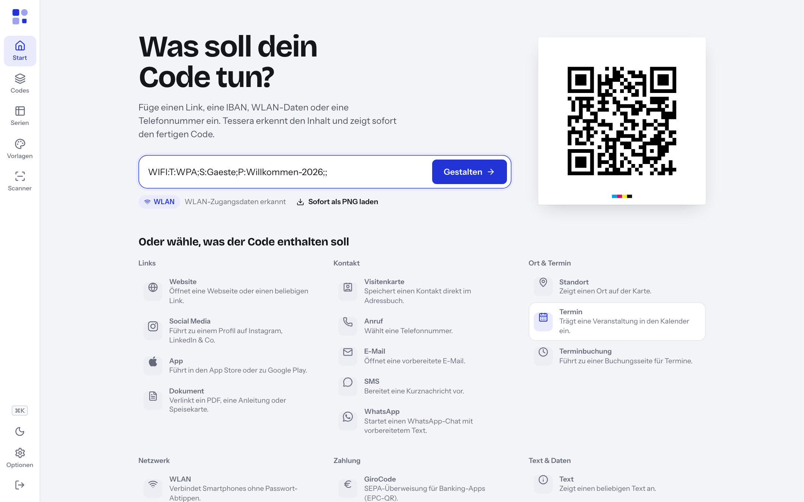
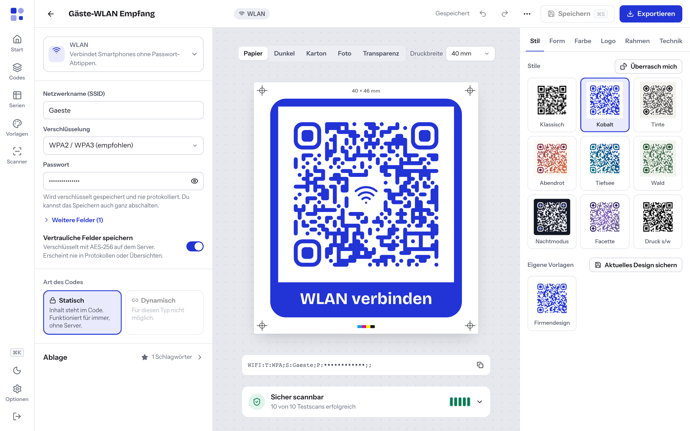

# 3 — Der erste Code

Einen einfachen Code erstellen Sie in etwa 30 Sekunden. Sie fügen den Inhalt
ein, Tessera erkennt ihn und zeigt sofort den fertigen Code. Wer mehr will,
wählt den Inhaltstyp selbst, gestaltet den Code und speichert ihn in der
Bibliothek.

## Der schnellste Weg: Schnelleingabe auf der Startseite

1. Klicken Sie in der Navigation auf **Start**.
2. Fügen Sie unter **Was soll dein Code tun?** den Inhalt in das Eingabefeld
   ein, zum Beispiel `www.beispiel.de` oder eine IBAN.
3. Tessera erkennt den Inhalt. Unter dem Feld erscheint der erkannte Typ
   mit einer kurzen Begründung, etwa **Website** · „Webadresse erkannt“.
   Rechts sehen Sie den fertigen Code als Vorschau.
4. Wählen Sie nun einen der beiden Wege:
   - **Sofort als PNG laden** lädt den Code direkt herunter (PNG, 1024 Pixel,
     Standardgestaltung). Der Code wird dabei **nicht** gespeichert.
   - **Gestalten** (oder die Eingabetaste) öffnet den Code im Editor. Dort
     sind die Felder bereits ausgefüllt.

Ein Zeilenumbruch im Eingabefeld gelingt mit **Umschalt + Eingabe**.
Mehrzeilige Inhalte wie eine vCard können Sie direkt einfügen.

### Was die Schnelleingabe erkennt

| Sie fügen ein … | Tessera erkennt |
| --- | --- |
| eine Webadresse, z. B. `beispiel.de/angebot` | Website |
| einen Link auf eine PDF-, Word-, Excel-, PowerPoint- oder OpenDocument-Datei | Dokument |
| einen Google-Maps-, Apple-Karten- oder OpenStreetMap-Link mit Koordinaten | Standort |
| Koordinaten wie `52.5163, 13.3777` oder einen `geo:`-Link | Standort |
| einen `wa.me`-Link | WhatsApp |
| einen Link zu `apps.apple.com` oder `play.google.com` | App |
| einen `paypal.me`-Link | PayPal |
| einen Link zu Calendly, Cal.com, Microsoft Bookings oder Doctolib | Terminbuchung |
| einen Profil-Link, z. B. LinkedIn oder Instagram | Social Media |
| eine IBAN | GiroCode |
| den Inhalt eines vorhandenen GiroCodes | GiroCode |
| eine E-Mail-Adresse oder einen `mailto:`-Link | E-Mail |
| eine Telefonnummer oder einen `tel:`-Link | Anruf |
| einen `SMSTO:`- oder `sms:`-Text | SMS |
| einen WLAN-Text (`WIFI:…`) | WLAN |
| eine vCard (`BEGIN:VCARD`) oder MECARD | Visitenkarte |
| einen Kalendereintrag (`BEGIN:VEVENT` oder `BEGIN:VCALENDAR`) | Termin |
| einen `bitcoin:`-Link | Bitcoin |
| alles andere | Text („Als Text übernommen“) |

Stimmt der erkannte Typ nicht, ändern Sie ihn im Editor (siehe unten).

## Der zweite Weg: Typ selbst wählen

1. Scrollen Sie auf der Startseite zu **Oder wähle, was der Code enthalten soll**.
2. Klicken Sie auf den passenden Typ, zum Beispiel **WLAN** oder
   **Visitenkarte**. Die Typen sind in die Gruppen **Links**, **Kontakt**,
   **Ort & Termin**, **Netzwerk**, **Zahlung** und **Text & Daten** sortiert.
3. Der Editor öffnet sich mit einem leeren Formular.

Einen neuen Code beginnen Sie auch von jeder Seite aus mit der Taste **N**
oder über die Befehlspalette (⌘K bzw. Strg+K) → **Neuer Code**.

Alle 18 Typen mit ihren Feldern beschreibt [Kapitel 4](04-inhaltstypen.md).

## Der Editor im Überblick

| Bereich | Inhalt |
| --- | --- |
| Oben | Name des Codes, Typ, Speicherstand, **Rückgängig**, **Wiederholen**, **Speichern**, **Exportieren** |
| Links | Inhalt: Typ, Felder, **Art des Codes**, **Ablage** |
| Mitte | Der Code als Andruck mit Maßangabe und Lesbarkeitsprüfung |
| Rechts | Das Designstudio ([Kapitel 5](05-gestalten.md)) |

### Inhalt eingeben

1. Prüfen Sie oben links den Typ. Um ihn zu ändern, klicken Sie darauf. Im
   Fenster **Was soll der Code tun?** können Sie suchen, zum Beispiel nach
   „Rechnung“ oder „Instagram“.
2. Füllen Sie die Felder aus. Die Vorschau in der Mitte ändert sich sofort.
   Solange der Inhalt leer oder unvollständig ist, zeigt Tessera eine
   Vorschau mit Beispielinhalt.
3. Selten benötigte Felder liegen unter **Weitere Felder (…)**.
4. Fehlermeldungen erscheinen erst, wenn Sie etwas eingeben oder speichern
   wollen. Ein leeres Formular bleibt ohne rote Hinweise.

Wird der Inhalt zu groß, meldet Tessera „Zu viele Daten für einen QR-Code“
und schlägt vor, den Inhalt zu kürzen, die Fehlerkorrektur zu senken oder
einen dynamischen Code zu verwenden.

### Statisch oder dynamisch

Unter **Art des Codes** wählen Sie:

- **Statisch**: Der Inhalt steht im Code. Er funktioniert für immer, ohne
  Server.
- **Dynamisch**: Der Code enthält einen Kurzlink über Tessera. Das Ziel lässt
  sich später ändern. Nicht jeder Typ unterstützt das.

Was das im Alltag bedeutet, erklären [Kapitel 1](01-was-ist-tessera.md) und
[Kapitel 10](10-dynamische-codes.md).

### Name vergeben

Ganz oben steht der Name des Codes. Lassen Sie das Feld leer, verwendet
Tessera eine Kurzbeschreibung des Inhalts, zum Beispiel die Webadresse oder
den Netzwerknamen. Ein sprechender Name wie „Empfang – Gäste-WLAN“ hilft
später beim Suchen.

## Speichern

1. Klicken Sie oben rechts auf **Speichern** oder drücken Sie
   **⌘S** (Mac) bzw. **Strg+S** (Windows).
2. Tessera meldet „Gespeichert“ (bei späteren Speicherungen „Änderungen
   gespeichert“). Der Code liegt jetzt in der Bibliothek
   unter **Codes**.

Ungespeicherte Änderungen zeigt Tessera oben mit **Nicht gespeichert** an.
Verlassen Sie den Editor vorher, fragt Tessera **Änderungen verwerfen?**.
Wählen Sie **Weiter bearbeiten**, um zurückzukehren, oder **Verwerfen**.

Wer die Rolle **Nur ansehen** hat, sieht keinen Knopf **Speichern**. Codes
ansehen und exportieren ist trotzdem möglich (siehe
[Kapitel 12](12-benutzer-und-anmeldung.md)).

### Ablage gleich mitpflegen

Im Abschnitt **Ablage** links unten (zum Aufklappen anklicken) ordnen Sie
den Code direkt ein:
**Ordner** (mit **Neu** legen Sie einen Ordner an), **Schlagwörter**,
**Favorit** und eine **Notiz**, die nur intern sichtbar ist. Mehr dazu in
[Kapitel 8](08-bibliothek.md).

### Weitere Aktionen

Bei gespeicherten Codes öffnet das Menü **Weitere Aktionen** (drei Punkte
oben rechts):

| Eintrag | Wirkung |
| --- | --- |
| **Duplizieren** | Legt eine Kopie an und öffnet sie |
| **Gespeicherte Fassung öffnen** | Zeigt die zuletzt gespeicherte Fassung als PNG in einem neuen Tab |
| **In den Papierkorb** | Verschiebt den Code in den Papierkorb. Sie können ihn wiederherstellen. |

Bei dynamischen Codes warnt Tessera vor dem Löschen: Gedruckte Exemplare
zeigen danach eine Hinweisseite.

## Exportieren

Klicken Sie auf **Exportieren** oder drücken Sie ⌘E bzw. Strg+E. Formate,
Größen und Drucktipps beschreibt [Kapitel 7](07-exportieren-drucken.md).
Vorher lohnt ein Blick auf die Lesbarkeitsprüfung
([Kapitel 6](06-lesbarkeit.md)).

## Tastenkürzel

| Taste (Mac) | Taste (Windows) | Wirkung |
| --- | --- | --- |
| N | N | Neuer Code |
| ⌘K | Strg+K | Befehlspalette öffnen |
| ⌘S | Strg+S | Speichern |
| ⌘E | Strg+E | Exportieren |
| ⌘Z | Strg+Z | Rückgängig |
| ⇧⌘Z | Umschalt+Strg+Z | Wiederholen |
| / | / | In der Bibliothek: Suche |

In Textfeldern wirken ⌘Z bzw. Strg+Z wie gewohnt auf den Text.

---

← [2 — Installation](02-installation.md) | [Inhalt](README.md) | [4 — Inhaltstypen](04-inhaltstypen.md) →
