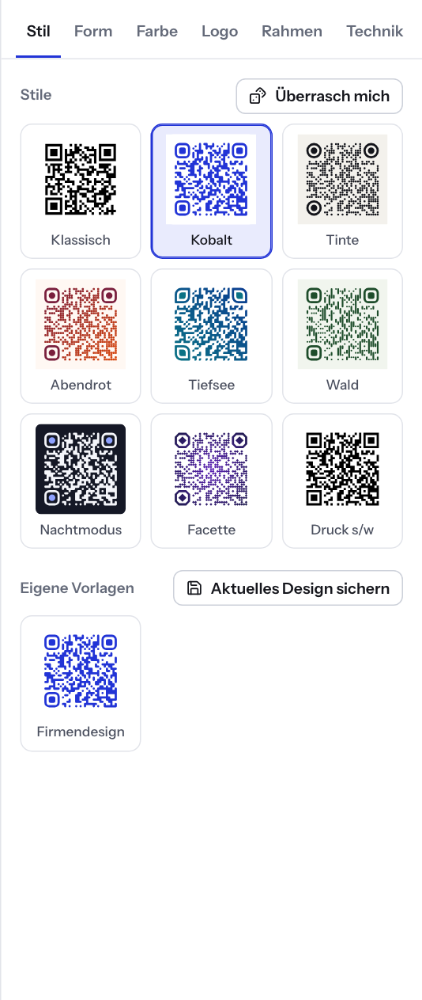
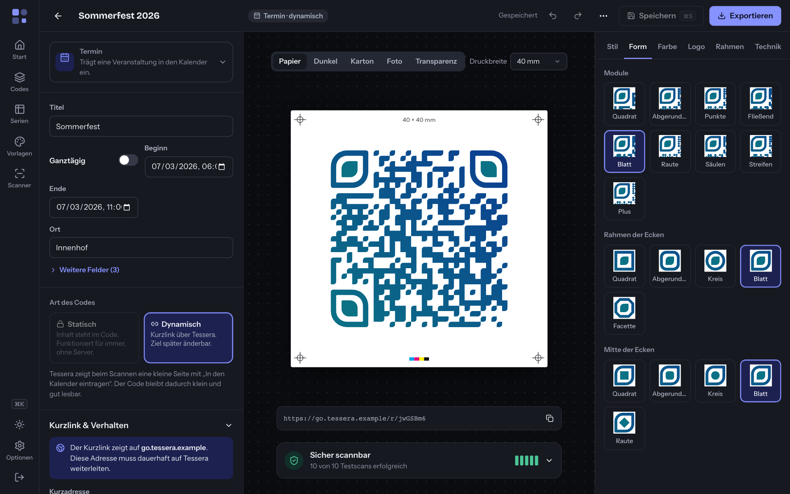

# 5 — Gestalten

Im Editor gestalten Sie das Aussehen Ihres Codes. Die rechte Spalte heißt
Designstudio. Sie hat sechs Reiter: **Stil**, **Form**, **Farbe**, **Logo**,
**Rahmen** und **Technik**. Jede Änderung sehen Sie sofort in der Mitte auf
dem Andruckbogen. Gleichzeitig prüft Tessera, ob der Code noch lesbar ist
(siehe [Kapitel 6](06-lesbarkeit.md)).

Der Editor ist dreigeteilt:

| Bereich | Inhalt |
| --- | --- |
| Links | Der Inhalt des Codes (siehe [Kapitel 4](04-inhaltstypen.md)) |
| Mitte | Der Andruckbogen mit Maßangabe, Untergrund-Test und Lesbarkeitsprüfung |
| Rechts | Das Designstudio |

Auf schmaleren Bildschirmen rückt das Designstudio unter die beiden anderen
Bereiche.

Tipp: Hat ein Reiter den Fokus, wechseln Sie mit den Pfeiltasten ← und →
zum Nachbarreiter.

## Reiter „Stil“

Hier finden Sie fertige Gestaltungen. Das ist der schnellste Weg zu einem
ansprechenden Code.

### Stile

Klicken Sie auf eine Kachel unter **Stile**. Tessera übernimmt Formen und
Farben. Logo und Beschriftung bleiben erhalten. Der aktive Stil ist
hervorgehoben.

| Stil | Aussehen |
| --- | --- |
| **Klassisch** | Schwarz auf Weiß, eckige Module |
| **Kobalt** | Fließende Module in Kobaltblau, abgerundete Ecken |
| **Tinte** | Punkte in Fast-Schwarz auf cremefarbenem Grund, runde Ecken |
| **Abendrot** | Verlauf von Weinrot nach Orange, abgerundet |
| **Tiefsee** | Blattform mit Blau-Petrol-Verlauf |
| **Wald** | Säulen in Dunkelgrün auf hellem Grün |
| **Nachtmodus** | Heller Code auf dunklem Grund |
| **Facette** | Rauten mit violettem Radialverlauf |
| **Druck s/w** | Schwarz, eckig, ohne Hintergrund, Fehlerkorrektur Q |

Alle mitgelieferten Stile sind auf Lesbarkeit geprüft. Für Industrie- und
Lagerscanner wählen Sie **Klassisch** oder **Druck s/w**. Mehr dazu unter
„Gut zu wissen“ am Ende dieses Kapitels.

### Überrasch mich

**Überrasch mich** würfelt eine neue Gestaltung aus Form, Augen und Farben.
Tessera wählt dabei nur Farbkombinationen mit sehr deutlichem Kontrast.
Gefällt Ihnen das Ergebnis nicht, klicken Sie erneut oder nehmen Sie den
Schritt mit **Rückgängig** zurück.

### Eigene Vorlagen

Ihr Firmendesign speichern Sie einmal als Vorlage und verwenden es für jeden
neuen Code.

1. Gestalten Sie den Code mit Farben, Formen, Logo und Rahmen.
2. Klicken Sie im Reiter **Stil** auf **Aktuelles Design sichern**.
3. Geben Sie unter **Name der Vorlage** einen Namen ein, z. B. „Firmendesign“.
4. Klicken Sie auf **Vorlage speichern**.

Die Vorlage übernimmt Farben, Formen, Logo und Rahmen. Den Inhalt übernimmt
sie nicht. Ihre Vorlagen erscheinen danach unter **Eigene Vorlagen**. Ein
Klick wendet die Vorlage auf den aktuellen Code an.

### Vorlagen verwalten

Alle Vorlagen sehen Sie in der Navigation unter **Vorlagen**.

| Aktion | So geht es |
| --- | --- |
| Neuen Code mit Vorlage beginnen | Auf das Vorschaubild der Vorlage klicken |
| Umbenennen | Stiftsymbol (**Umbenennen**) → Namen ändern → **Speichern** |
| Löschen | Papierkorbsymbol (**Löschen**) → bestätigen. Bereits erstellte Codes behalten ihr Design. |
| Als Standard festlegen (nur Administration) | Sternsymbol (**Als Standard für neue Codes**). Jeder neue Code startet dann mit dieser Vorlage. Ein zweiter Klick hebt das wieder auf. |

Vorlagen speichern, umbenennen und löschen dürfen Konten mit der Rolle
Administration oder Bearbeiten (siehe [Kapitel 12](12-benutzer-und-anmeldung.md)).

## Reiter „Form“

Hier legen Sie die Form der einzelnen Punkte (Module) und der drei großen
Ecken fest. Die Ecken heißen auch „Augen“. An ihnen erkennt die Kamera den
Code.

**Module** – neun Formen: **Quadrat**, **Abgerundet**, **Punkte**,
**Fließend**, **Blatt**, **Raute**, **Säulen**, **Streifen**, **Plus**.

**Modulgröße** – Schieberegler von 60 % bis 100 %. Kleinere Module wirken
luftiger, sind aber schwerer zu lesen. Bei **Fließend** und **Blatt** fehlt
der Regler, weil diese Formen ineinander übergehen.

**Rahmen der Ecken** – **Quadrat**, **Abgerundet**, **Kreis**, **Blatt**,
**Facette**.

**Mitte der Ecken** – **Quadrat**, **Abgerundet**, **Kreis**, **Blatt**,
**Raute**.

Hinweis: Bei Modulgröße unter 80 % sowie bei den Formen **Plus** und
**Raute** zeigt die Lesbarkeitsprüfung einen Hinweis. Diese Formen verringern
die Fläche, die eine Kamera erkennt.

## Reiter „Farbe“

1. Wählen Sie oben eine der zehn Schnellfarben. Sie färbt den Code und den
   Rahmen.
2. Oder stellen Sie unter **Code** die Art ein: **Farbe** (einfarbig),
   **Verlauf** (linear, mit Regler **Winkel**) oder **Radial** (von der
   Mitte nach außen). Bei Verläufen wählen Sie eine Start- und eine
   Endfarbe.
3. Unter **Hintergrund** stehen dieselben Arten zur Wahl, dazu **Ohne**.
   **Ohne** exportiert den Code ohne Hintergrund. Das eignet sich für
   Druckvorlagen auf hellem Papier.

Weitere Einstellungen:

| Einstellung | Wirkung |
| --- | --- |
| **Farben tauschen** | Vertauscht Code- und Hintergrundfarbe. Bei Hintergrund **Ohne** nicht verfügbar. |
| **Eigene Farbe für Eckrahmen** | Färbt die Rahmen der drei Ecken gesondert |
| **Eigene Farbe für Eckmitte** | Färbt die Mitte der drei Ecken gesondert |
| **Ecken des Hintergrunds** | Rundet die Hintergrundfläche ab, von **eckig** bis 20 % |

Achten Sie auf Kontrast: dunkler Code auf hellem Grund ist am sichersten.
Heller Code auf dunklem Grund lesen aktuelle Smartphones, manche älteren
Scanner aber nicht. Die Lesbarkeitsprüfung warnt in beiden Fällen
rechtzeitig.

## Reiter „Logo“

Wählen Sie oben **Ohne**, **Symbol** oder **Eigenes Bild**.

### Symbol

Tessera bringt 48 Symbole mit: allgemeine Symbole und Markenzeichen wie
Instagram. Über **Symbol suchen** finden Sie ein Symbol nach Namen. Die
Symbolnamen sind englisch, suchen Sie also z. B. nach „phone“ statt
„Telefon“. Das
Symbol übernimmt die Codefarbe. Mit **Eigene Symbolfarbe** geben Sie ihm
eine eigene Farbe. Bei Markenzeichen schlägt Tessera dafür die Markenfarbe
vor.

### Eigenes Bild

1. Klicken Sie auf **Logo hochladen** oder ziehen Sie die Datei in das Feld.
2. Erlaubt sind PNG, JPG, WebP und SVG. SVG-Dateien dürfen höchstens 900 KB
   groß sein. Andere Bilder verkleinert Tessera auf höchstens 600 Pixel.
3. Mit **Logo ersetzen** tauschen Sie das Bild aus, mit **Logo entfernen**
   löschen Sie es.

### Einstellungen für Symbol und Bild

| Einstellung | Wirkung |
| --- | --- |
| **Größe** | 10 % bis 32 % der Codebreite |
| **Innenabstand** | Freiraum zwischen Logo und Code, 0 % bis 35 % |
| **Fläche hinter dem Logo** | Form der Fläche: **Eckig**, **Abgerundet** oder **Rund** |
| **Module unter dem Logo aussparen** | Empfohlen. Sonst überdeckt das Logo Teile des Codes. |
| **Eigene Farbe der Logofläche** | Färbt die Fläche hinter dem Logo (nur bei ausgesparten Modulen) |

Ein Logo verdeckt immer einen Teil der Daten. Die Fehlerkorrektur gleicht
das aus. Bei automatischer Fehlerkorrektur wählt Tessera mit Logo die
höchste Stufe H. Haben Sie unter **Technik** eine niedrigere Stufe fest
eingestellt, erscheint der Hinweis „Mit Logo ist Fehlerkorrektur H am
sichersten.“ Klicken Sie dann auf **Auf H stellen**.

## Reiter „Rahmen“

Ein Rahmen setzt eine Aufforderung wie „Scan mich“ an den Code. Sieben
Varianten stehen zur Wahl: **Ohne**, **Karte**, **Banner oben**,
**Etikett**, **Sprechblase**, **Bildunterschrift**, **Sucher**.

Nach der Wahl eines Rahmens erscheinen diese Felder:

| Feld | Bedeutung |
| --- | --- |
| **Beschriftung** | Text bis 40 Zeichen. Vorschläge per Klick: **Scan mich**, **Jetzt scannen**, **WLAN verbinden**, **Kontakt speichern**, **Mehr erfahren**, **Termin buchen** |
| **Schrift** | **Bricolage**, **Instrument Sans**, **Fraunces**, **JetBrains Mono** |
| **Rahmenfarbe** | Farbe des Rahmens. Bei **Bildunterschrift** und **Sucher** heißt das Feld **Farbe**. |
| **Schriftfarbe** | Farbe des Textes im Rahmen (nicht bei **Bildunterschrift** und **Sucher**) |

Die Beschriftung wird beim Export in Vektorpfade umgewandelt. Der Text sieht
deshalb überall gleich aus, auch ohne installierte Schrift.

## Reiter „Technik“

| Einstellung | Bedeutung |
| --- | --- |
| **Fehlerkorrektur** | **Auto**, **L**, **M**, **Q** oder **H**. Die Stufe bestimmt, wie viel Beschädigung der Code verträgt: L 7 %, M 15 %, Q 25 %, H 30 %. Mehr Korrektur macht den Code dichter. |
| **Ruhezone (Rand)** | Freier Rand um den Code, 0 bis 10 Module. Der Standard verlangt 4 Module. |
| **Design zurücksetzen** | Stellt alle Gestaltungseinstellungen auf Schwarz-Weiß und Quadrat zurück, ohne Logo und Rahmen. Mit **Rückgängig** holen Sie das alte Design zurück. |

Die Automatik (**Auto**) wählt so:

| Situation | Gewählte Stufe |
| --- | --- |
| Mit Logo oder Symbol | H |
| Klassische, eckige Module in voller Größe | M |
| Alle anderen gestalteten Formen | Q |

Manche Inhaltstypen verlangen eine Mindeststufe. Der GiroCode zum Beispiel
nutzt immer mindestens M, wie es der Standard vorsieht. Wir empfehlen, die
Einstellung auf **Auto** zu lassen.

## Rückgängig und Wiederholen

Oben in der Leiste des Editors finden Sie die Pfeile **Rückgängig** und
**Wiederholen**.

| Aktion | Mac | Windows |
| --- | --- | --- |
| Rückgängig | ⌘Z | Strg+Z |
| Wiederholen | ⇧⌘Z | Umschalt+Strg+Z |

Tessera merkt sich die letzten 50 Gestaltungsschritte. Schnelle Bewegungen
an einem Schieberegler zählen als ein Schritt. Rückgängig betrifft nur das
Design, nicht den Inhalt. In Textfeldern wirken die Tastenkürzel wie gewohnt
auf den Text. Auf schmalen Bildschirmen (Smartphone) sind die beiden
Schaltflächen ausgeblendet.

Vergessen Sie nicht zu speichern: **Speichern** oder ⌘S bzw. Strg+S. Solange
„Nicht gespeichert“ in der Leiste steht, sind Änderungen nur im Browser.
Verlassen Sie den Editor vorher, fragt Tessera **Änderungen verwerfen?**
nach.

## Heller und dunkler Modus

Die Oberfläche von Tessera gibt es hell und dunkel. Zunächst folgt sie der
Einstellung Ihres Betriebssystems. Umschalten können Sie so:

- In der linken Navigationsleiste auf das Mond- bzw. Sonnensymbol klicken
  (**Dunkles Design** / **Helles Design**).
- Oder mit ⌘K bzw. Strg+K die Befehlspalette öffnen und
  **Hell/Dunkel umschalten** wählen.

Die Wahl gilt nur für die Oberfläche in diesem Browser. Auf das Aussehen
Ihres Codes hat sie keinen Einfluss.

## Gut zu wissen

- **Stilisierte Ecken:** Ecken mit den Formen Abgerundet, Kreis, Blatt oder
  Facette lesen Smartphone-Kameras problemlos. Manche Industriescanner, die
  auf OpenCV beruhen, lesen sie nicht. Brauchen Sie maximale Kompatibilität,
  etwa für Lagerscanner, wählen Sie quadratische Ecken (Stil **Klassisch**
  oder **Druck s/w**).
- **SVG-Logos im PDF:** Im PDF-Export bettet Tessera SVG-Logos als Bild mit
  1600 Pixeln Breite ein. Code, Formen und Beschriftung bleiben Vektor.
  Details in [Kapitel 7](07-exportieren-drucken.md).

---

← [4 — Inhaltstypen](04-inhaltstypen.md) | [Inhalt](README.md) | [6 — Lesbarkeit](06-lesbarkeit.md) →
