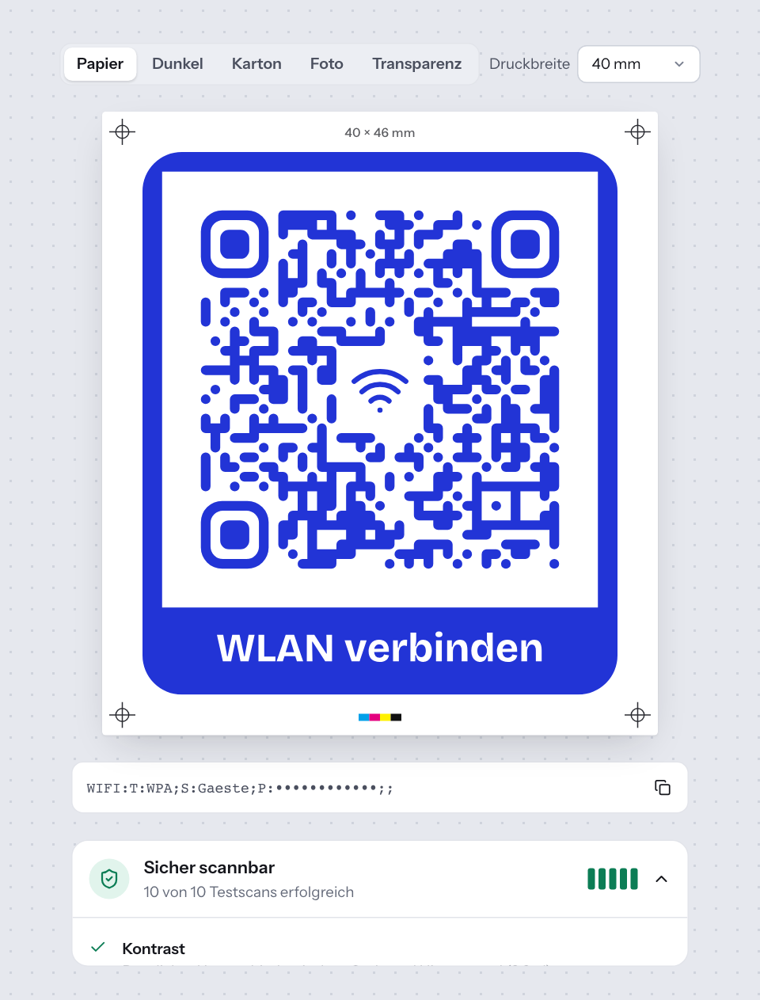

# 6 — Lesbarkeit

Ein schöner Code nützt nichts, wenn ihn das Smartphone nicht liest. Tessera
prüft deshalb jede Änderung automatisch. Das Ergebnis sehen Sie im Editor
unter dem Andruckbogen in der Leiste **Lesbarkeitsprüfung**. Auf dem
Smartphone steht sie unter dem Inhaltsbereich, vor dem Designstudio.

## Die Ampel

Die Leiste zeigt eines von drei Ergebnissen:

| Anzeige | Bedeutung | Was tun? |
| --- | --- | --- |
| **Sicher scannbar** (grün) | Alle Regeln erfüllt, die Testscans gelingen. | Nichts. Sie können exportieren. |
| **Scannbar, mit Einschränkungen** (gelb) | Der Code wird gelesen, aber nicht unter allen Bedingungen. | Hinweise lesen und Vorschläge übernehmen, wenn es geht. |
| **Wahrscheinlich nicht lesbar** (rot) | Eine Regel ist verletzt oder die Testscans scheitern. | Vorschläge übernehmen. Der Export ist gesperrt. |

Solange die Prüfung läuft, steht dort **Lesbarkeit wird geprüft**. Ist der
Inhalt noch unvollständig, steht dort nur **Lesbarkeit** und darunter
„Startet, sobald der Inhalt vollständig ist.“

Unter dem Ergebnis steht eine Zusammenfassung, z. B. „8 von 10 Testscans
erfolgreich · 2 Hinweise“. Die fünf Balken rechts stehen für die fünf
Testsituationen: grün = beide Decoder lesen den Code, gelb = einer, rot =
keiner.

**Klicken Sie auf die Leiste**, um die Einzelheiten aufzuklappen.

## Zwei Prüfungen

Tessera prüft auf zwei Wegen:

1. **Regelprüfung.** Sie läuft sofort im Browser bei jeder Änderung. Sie
   bewertet Kontrast, Rand, Logo, Dichte und Druckgröße.
2. **Testscans.** Kurz nach Ihrer letzten Änderung erzeugt der Server den
   Code genau so, wie er exportiert wird. Dann versucht er, ihn unter
   erschwerten Bedingungen zu lesen. Während das läuft, steht in der
   Zusammenfassung „prüfe erneut …“.

Ist der Server für die Testscans gerade nicht erreichbar, steht dort
„Testscans gerade nicht verfügbar, nur Regelprüfung“. Das Ergebnis beruht
dann nur auf den Regeln.

## Die Regeln im Einzelnen

| Regel | Was geprüft wird | Grün | Gelb | Rot | Vorschlag per Klick |
| --- | --- | --- | --- | --- | --- |
| **Kontrast** | Unterschied zwischen Code- und Hintergrundfarbe. Geprüft wird das ungünstigste Paar, auch eigene Eckfarben. | ab 4,5 : 1 | 3 : 1 bis 4,5 : 1 | unter 3 : 1 | **Code dunkler färben** bzw. **Hellen Hintergrund verwenden** |
| **Helle Module** | Heller Code auf dunklem Grund | – | immer | – | **Farben tauschen** |
| **Transparenter Hintergrund** | Hintergrund **Ohne**. Die Lesbarkeit hängt dann vom Untergrund ab. | – | immer | – | **Weißen Hintergrund verwenden** |
| **Ruhezone** | Freier Rand um den Code | ab 4 Module | 2 bis 3 Module | unter 2 Module | **Rand auf 4 Module setzen** |
| **Logo** | Anteil der Daten, den das Logo verdeckt, im Verhältnis zur Fehlerkorrektur | bis 55 % der Reserve | bis 85 % | darüber | **Fehlerkorrektur auf … erhöhen**, bei Stufe H **Logo verkleinern** |
| **Dichte** | Anzahl der Module | bis 57 × 57 | bis 97 × 97 | darüber | keiner. Inhalt kürzen, größer drucken oder dynamischen Kurzlink nutzen. |
| **Modulform** | Modulgröße unter 80 % oder Form **Plus** / **Raute** | – | immer | – | **Module vergrößern** (bei kleiner Modulgröße) |
| **Druckgröße** | Größe eines Moduls bei der gewählten Druckbreite | ab 0,5 mm | 0,33 bis 0,5 mm | unter 0,33 mm | keiner. Größere Druckbreite wählen. |
| **Fehlerkorrektur** | Stufe L bei Logo oder gestalteter Form | – | immer | – | **Automatik verwenden** |

Die Begriffe Modul, Ruhezone und Fehlerkorrektur erklärt
[Kapitel 1](01-was-ist-tessera.md).

Ein Beispiel zum Logo: Die Fehlerkorrektur H gleicht bis zu 30 % Schaden
aus. Verdeckt ein Logo 12 % der Daten, nutzt es 40 % dieser Reserve. Das ist
grün. Verdeckt es 20 %, sind es 67 %. Das ist gelb.

## Die Testscans

Der Server liest den Code in fünf nachgestellten Situationen:

| Situation | Was nachgestellt wird |
| --- | --- |
| **Ideale Bedingungen** | Saubere Aufnahme in normaler Größe |
| **Kleine Darstellung** | Nur rund 2 bis 3 Bildpunkte pro Modul, wie aus großer Entfernung |
| **Unscharfe Kamera** | Weichgezeichnetes Bild |
| **Schwaches Licht** | Geringer Kontrast, ungleichmäßige Helligkeit, Bildrauschen |
| **Schräg gehalten** | Gedreht bis 22 Grad und leicht verzerrt |

Jede Situation prüft Tessera in drei Größen, wie eine Kamera aus wechselnder
Entfernung. Zwei unabhängige Decoder lesen jedes Bild:

- **ZXing** (ZXing-C++), der Decoder vieler Android-Apps.
- **jsQR**, ein bewusst strengerer Decoder. Er steht für schwächere
  Scanner.

Ein Decoder gilt in einer Situation als erfolgreich, wenn er mindestens zwei
der drei Größen liest. Fünf Situationen mal zwei Decoder ergeben die zehn
Testscans der Zusammenfassung. Die Tabelle **Simulierte Situation** in der
aufgeklappten Leiste zeigt jedes Ergebnis mit Haken oder Kreuz.

So entsteht das Gesamturteil:

- Liest ZXing den Code unter **Ideale Bedingungen** nicht oder liest er
  etwas anderes als den Inhalt, ist das Ergebnis rot.
- Sonst bildet Tessera eine gewichtete Punktzahl. Ideale Bedingungen zählen
  am meisten, Schräg gehalten am wenigsten. Ab 85 % ist das Ergebnis grün,
  ab 55 % gelb, darunter rot.
- Die Ampel zeigt das schlechtere Ergebnis aus Regelprüfung und Testscans.

## Vorschläge übernehmen

1. Klappen Sie die **Lesbarkeitsprüfung** auf.
2. Neben jedem Hinweis mit Lösung steht eine Schaltfläche, z. B.
   **Rand auf 4 Module setzen**. Klicken Sie darauf.
3. Gibt es mehrere Vorschläge, übernimmt **Alle Vorschläge übernehmen** sie
   in einem Schritt.

Jeder Vorschlag ist ein normaler Gestaltungsschritt. Mit **Rückgängig**
nehmen Sie ihn zurück.

## Export-Sperre

Ist das Ergebnis **Wahrscheinlich nicht lesbar**, sperrt Tessera im Dialog
**Exportieren** alle Schaltflächen. Der Dialog zeigt den Hinweis „Dieser Code
ist wahrscheinlich nicht lesbar.“

Wollen Sie trotzdem exportieren, etwa für einen Test, schalten Sie
**Ich weiß das und möchte trotzdem exportieren** ein. Die Freigabe gilt nur,
solange der Dialog offen ist. Beim nächsten Öffnen ist die Sperre wieder
aktiv.

Enthält der Code zu viele Daten, zeigt der Andruckbogen „Zu viele Daten für
einen QR-Code“. Kürzen Sie dann den Inhalt, senken Sie die Fehlerkorrektur
oder nutzen Sie einen [dynamischen Code](10-dynamische-codes.md).

## Untergrund testen

Über dem Andruckbogen wählen Sie unter **Untergrund**, worauf der Code
liegen soll:

| Untergrund | Wofür |
| --- | --- |
| **Papier** | Standard, weißes Papier |
| **Dunkel** | Dunkle Flächen |
| **Karton** | Braunes Kraftpapier, Verpackungen |
| **Foto** | Unruhiger Untergrund, z. B. ein Plakatmotiv |
| **Transparenz** | Schachbrettmuster, zeigt durchsichtige Bereiche |

Das ist eine Sichtprüfung für Sie. Die Testscans des Servers prüfen einen
Code ohne Hintergrund immer auf Weiß. Besonders bei Hintergrund **Ohne**
lohnt deshalb ein Blick auf **Dunkel** und **Foto**.

## Druckgröße

Rechts über dem Andruckbogen wählen Sie die **Druckbreite** aus einer Liste
von 15 mm bis 300 mm. Voreingestellt sind 40 mm. Der Andruckbogen zeigt die Maße an, z. B.
„40 × 40 mm“.

Die Regel **Druckgröße** rechnet daraus aus, wie groß ein Modul wird.
Empfohlen sind mindestens 0,5 mm pro Modul. Ein dichter Code braucht deshalb
mehr Fläche als ein kurzer.

Die gewählte Druckbreite übernimmt der Exportdialog für SVG und PDF.

## Faustregel: Entfernung geteilt durch 10

Wie groß ein Code sein muss, hängt davon ab, aus welcher Entfernung man ihn
scannt. Die Faustregel lautet: **Breite = Scan-Entfernung geteilt durch 10.**

| Scan-Entfernung | Mindestbreite nach Faustregel |
| --- | --- |
| 30 cm (Visitenkarte, Flyer in der Hand) | 3 cm |
| 1 m (Aushang, Empfangstresen) | 10 cm |
| 2 m (Plakat im Flur) | 20 cm |
| 5 m | 50 cm |
| 10 m | 1 m |

Tessera rechnet im Rechner **Wie groß drucken?** genauer: Es nimmt den
größten der drei Werte aus Faustregel, 0,5 mm pro Modul und mindestens 2 cm.
Ein dichter Code kann also mehr verlangen als die Tabelle. Den Rechner finden
Sie im Exportdialog (siehe [Kapitel 7](07-exportieren-drucken.md)).

## Grenzen der Prüfung

Die Testscans sind eine Simulation. Tessera wurde mit vier unabhängigen
Software-Decodern geprüft, nicht mit echten iPhone- oder Android-Kameras und
gedruckten Exemplaren. Drucken Sie vor einer großen Auflage ein Probeexemplar
und scannen Sie es mit zwei oder drei verschiedenen Smartphones.

Für Industriescanner gilt außerdem: Codes mit stilisierten Ecken (Abgerundet,
Kreis, Blatt, Facette) liest der Decoder OpenCV nicht. Wählen Sie dafür
quadratische Ecken (siehe [Kapitel 5](05-gestalten.md)).

---

← [5 — Gestalten](05-gestalten.md) | [Inhalt](README.md) | [7 — Exportieren und drucken](07-exportieren-drucken.md) →
