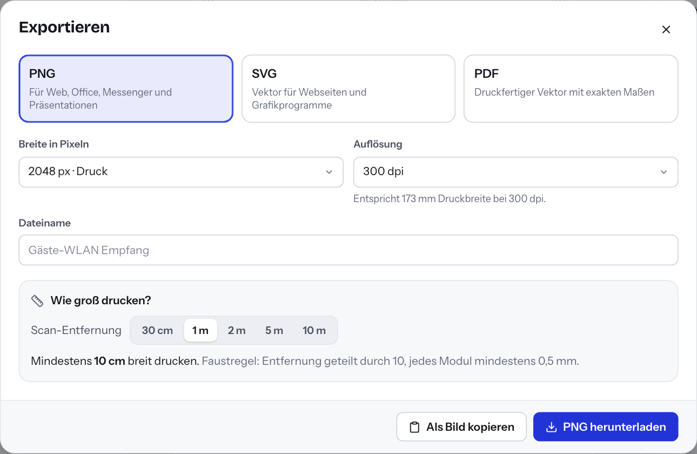

# 7 — Exportieren und drucken

Ist der Code fertig, speichern Sie ihn als Datei für Web, Office oder
Druckerei. Tessera liefert PNG, SVG und PDF. Der Export erzeugt den Code
genau so, wie Sie ihn in der Vorschau sehen.

## Exportdialog öffnen

1. Öffnen Sie den Code im Editor.
2. Klicken Sie oben rechts auf **Exportieren**. Alternativ: ⌘E (Mac) bzw.
   Strg+E (Windows).

Exportieren dürfen alle Rollen, auch **Nur ansehen**. Speichern müssen Sie
dafür nicht. Tessera exportiert immer den aktuellen Stand im Editor.

Ist die Lesbarkeitsprüfung rot, sind die Schaltflächen zunächst gesperrt.
Siehe [Kapitel 6, Export-Sperre](06-lesbarkeit.md#export-sperre).

## Welches Format?

| Format | Beschreibung in Tessera | Geeignet für |
| --- | --- | --- |
| **PNG** | Für Web, Office, Messenger und Präsentationen | Word, Outlook, Teams, PowerPoint, Webseiten, E-Mail-Signaturen |
| **SVG** | Vektor für Webseiten und Grafikprogramme | Webseiten, Grafikprogramme wie Illustrator, Inkscape oder Affinity |
| **PDF** | Druckfertiger Vektor mit exakten Maßen | Druckerei, Flyer, Plakate, Etiketten |

Wenn Sie unsicher sind: Für den Bildschirm PNG, für den Druck PDF.

## PNG: Pixel und Auflösung

| Feld | Auswahl |
| --- | --- |
| **Breite in Pixeln** | 256, 512 (**Web**), 1024, 2048 (**Druck**), 4096, 8000 px (**Plakat**) |
| **Auflösung** | 72, 150, 300, 600 oder 1200 dpi |

Die Auflösung legt fest, wie groß das Bild gedruckt wird. Tessera schreibt
den Wert in die Datei. Unter dem Feld steht, welche Druckbreite sich ergibt,
z. B. „Entspricht 173 mm Druckbreite bei 300 dpi.“

Beispiel: 2048 px bei 300 dpi ergeben gut 17 cm Breite. Für eine
Visitenkarte genügt das sicher.

Hinweis für IT: Ein PNG mit 8000 px braucht auf dem Server etwa 2 bis
3 Sekunden. In dieser Zeit reagiert Tessera für andere Nutzer spürbar
langsamer.

## SVG und PDF: Millimeter

| Feld | Bedeutung |
| --- | --- |
| **Breite in Millimetern** | 10 bis 1000 mm. Voreingestellt ist die **Druckbreite** aus dem Andruckbogen. |
| **Schnittmarken und 3 mm Beschnitt** | Nur bei PDF. Fügt 3 mm Beschnitt rundherum und Schnittmarken außerhalb hinzu. |

Die SVG-Datei trägt die Maße in Millimetern. Grafikprogramme öffnen sie
deshalb in der richtigen Größe.

Das PDF ist ein echter Vektor. Es lässt sich ohne Qualitätsverlust beliebig
vergrößern. Schalten Sie Schnittmarken und Beschnitt ein, wenn die Druckerei
das verlangt. Das ist meist bei randabfallendem Druck der Fall.

## Dateiname und Herunterladen

1. Das Feld **Dateiname** schlägt den Namen des Codes vor (grau). Geben Sie
   bei Bedarf einen anderen Namen ein. Umlaute und Sonderzeichen ersetzt
   Tessera im Dateinamen, z. B. „ä“ durch „ae“ und Leerzeichen durch „-“.
2. Klicken Sie auf **PNG herunterladen**, **SVG herunterladen** bzw.
   **PDF herunterladen**. Die Beschriftung folgt dem gewählten Format.
3. Die Datei landet im Download-Ordner Ihres Browsers.

## Als Bild kopieren

**Als Bild kopieren** legt den Code als PNG in die Zwischenablage. Fügen Sie
ihn dann direkt in Word, Outlook oder Teams ein (⌘V bzw. Strg+V). Tessera
verwendet dafür die eingestellte **Breite in Pixeln**.

Manche Browser erlauben das nicht. Dann erscheint die Meldung „Der Browser
hat das Kopieren blockiert. Nutze den Download.“ Laden Sie die Datei in
diesem Fall herunter.

## Teilen

Unterstützt der Browser das Teilen (meist auf Smartphones und Tablets),
erscheint zusätzlich **Teilen**. Damit geben Sie den Code als PNG direkt an
Mail, Messenger oder andere Apps weiter. In Browsern ohne diese Funktion
fehlt die Schaltfläche.

## Wie groß drucken?

Im Exportdialog finden Sie den Rechner **Wie groß drucken?**.

1. Wählen Sie unter **Scan-Entfernung**, aus welcher Entfernung man den Code
   scannen wird: **30 cm**, **1 m**, **2 m**, **5 m** oder **10 m**.
2. Tessera zeigt: „Mindestens … breit drucken.“

Der Rechner nutzt die Faustregel „Entfernung geteilt durch 10“. Zusätzlich
soll jedes Modul mindestens 0,5 mm groß sein, und der Code mindestens 2 cm.
Der größte dieser Werte gilt. Liegt die eingestellte Breite bei SVG oder PDF
darunter, warnt Tessera: „Die gewählte Breite von … mm ist für diese
Entfernung zu klein.“

Mehr zur Faustregel in [Kapitel 6](06-lesbarkeit.md#faustregel-entfernung-geteilt-durch-10).

## Gespeicherte Fassung öffnen

Bei einem gespeicherten Code öffnet das Menü **Weitere Aktionen** (drei
Punkte oben im Editor) den Eintrag **Gespeicherte Fassung öffnen**. Er zeigt
den zuletzt gespeicherten Stand als PNG mit 1024 Pixeln in einem neuen Tab.
Ungespeicherte Änderungen sind darin nicht enthalten.

## Tipps für die Druckerei

- **PDF schicken.** Es ist ein Vektor mit exakten Maßen. Die Beschriftung im
  Rahmen ist in Pfade umgewandelt. Die Druckerei braucht deshalb keine
  Schriften.
- **Farbraum RGB.** Tessera exportiert PDFs in RGB. Für Offsetdruck mit
  exakten CMYK- oder Sonderfarben bitten Sie die Druckerei, die Datei
  umzuwandeln. Prüfen Sie danach den Kontrast am Proof.
- **Kein EPS.** Einen EPS-Export gibt es nicht. PDF und SVG decken
  Vektor-Abläufe ab. Die meisten Druckereien nehmen PDF an.
- **SVG-Logos.** Ein Logo im SVG-Format bettet Tessera im PDF als Bild mit
  1600 Pixeln Breite ein. Für übliche Druckgrößen reicht das. Code, Formen
  und Beschriftung bleiben Vektor.
- **Ruhezone nicht beschneiden.** Der freie Rand gehört zum Code. Er darf
  nicht weggeschnitten oder mit Text bedruckt werden.
- **Nicht verzerren.** Die Druckerei soll den Code nur proportional
  skalieren.
- **Probedruck.** Drucken Sie ein Exemplar in Originalgröße auf dem
  Originalmaterial. Scannen Sie es mit mehreren Smartphones, bevor Sie die
  ganze Auflage freigeben.
- **Dynamische Codes.** Prüfen Sie vor dem Druck, ob der Kurzlink vom
  späteren Einsatzort aus erreichbar ist (siehe
  [Kapitel 10](10-dynamische-codes.md)).

Viele Codes auf einmal, etwa als Etikettenbogen, erzeugen Sie über
[Serien](09-serien.md).

---

← [6 — Lesbarkeit](06-lesbarkeit.md) | [Inhalt](README.md) | [8 — Bibliothek](08-bibliothek.md) →
