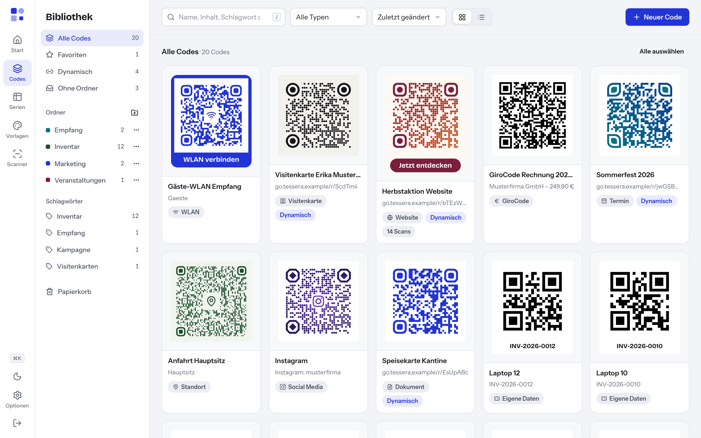

# 8 — Bibliothek

Die Bibliothek enthält alle gespeicherten Codes. Hier finden, ordnen und exportieren Sie Ihre Codes, einzeln oder viele auf einmal. Sie öffnen die Bibliothek über **Codes** in der Navigation. Die Seite trägt die Überschrift **Bibliothek**.

## Aufbau der Seite

| Bereich | Inhalt |
| --- | --- |
| Linke Spalte | **Alle Codes**, **Favoriten**, **Dynamisch**, **Ohne Ordner**, darunter **Ordner**, **Schlagwörter** und **Papierkorb**, jeweils mit Anzahl |
| Oben | Suchfeld, Typfilter, Sortierung, Umschalter **Ansicht** (**Raster** oder **Liste**), Knopf **Neuer Code** |
| Mitte | Die Codes als Karten (Raster) oder als Tabelle (Liste) |

Auf dem Smartphone ersetzt eine Auswahlliste **Bereich** die linke Spalte.

Weitere Codes lädt die Seite beim Herunterscrollen automatisch nach.

## Codes suchen

1. Klicken Sie in das Suchfeld oder drücken Sie die Taste **/**.
2. Geben Sie einen Suchbegriff ein.

Tessera durchsucht **Name, Inhalt, Schlagwort oder Kurzlink** sowie die interne **Notiz**. Die Trefferliste aktualisiert sich während der Eingabe.

Findet Tessera nichts, erscheint **Keine Treffer**. Ändern Sie dann die Suche oder entfernen Sie Filter.

## Filtern und sortieren

- **Typ:** Die Auswahl **Alle Typen** schränkt auf einen Inhaltstyp ein, z. B. nur Visitenkarten.
- **Bereich:** In der linken Spalte wählen Sie **Favoriten**, **Dynamisch**, **Ohne Ordner**, einen Ordner oder ein Schlagwort.
- **Sortierung:**

| Auswahl | Reihenfolge |
| --- | --- |
| **Zuletzt geändert** | Zuletzt bearbeitete Codes zuerst (Standard) |
| **Neueste zuerst** | Zuletzt angelegte Codes zuerst |
| **Name A–Z** | Alphabetisch nach Name |
| **Typ** | Nach Inhaltstyp |
| **Meiste Scans** | Nach gezählten Scans (nur sinnvoll bei eingeschalteter Statistik, siehe [Kapitel 10](10-dynamische-codes.md)) |

Hinweis: **Name A–Z** sortiert rein alphabetisch, nicht „natürlich“. „Laptop 10“ steht deshalb vor „Laptop 2“. Wer viele nummerierte Codes hat, vergibt Nummern mit führenden Nullen, z. B. „Laptop 002“.

## Ordner

Ein Code liegt in höchstens einem Ordner.

**Ordner anlegen:**

1. Klicken Sie in der linken Spalte neben **Ordner** auf das Symbol **Neuer Ordner**.
2. Geben Sie im Feld **Name des Ordners** den Namen ein und drücken Sie die Eingabetaste.

Einen neuen Ordner versieht Tessera automatisch mit einer Farbe. Ändern können Sie sie über **Umbenennen** (siehe unten).

Jeder Ordnername darf nur einmal vorkommen. Tessera meldet sonst „Einen Ordner „…“ gibt es schon.“

**Ordner bearbeiten:** Klicken Sie in der linken Spalte auf **…** neben dem Ordner und wählen Sie **Umbenennen**. Im Dialog **Ordner umbenennen** ändern Sie im Feld **Name** den Namen und wählen eine von sieben Farben. Klicken Sie auf **Speichern**. Mit **Ordner löschen** im selben Menü entfernen Sie den Ordner nach einer Rückfrage. Die Codes darin bleiben erhalten und landen unter **Ohne Ordner**.

**Code einem Ordner zuweisen:**

- Im Editor unter **Ablage** → **Ordner**. Mit **Neu** legen Sie dort direkt einen Ordner an.
- In der Bibliothek über das Menü des Codes → **Verschieben nach**.
- Für mehrere Codes über die Sammelaktion **Verschieben** (siehe unten).

## Schlagwörter

Schlagwörter ergänzen Ordner. Ein Code kann beliebig viele Schlagwörter tragen, z. B. „Empfang“ und „Herbstkampagne“.

- Im Editor vergeben Sie Schlagwörter unter **Ablage** → **Schlagwörter**.
- In der Bibliothek zeigt die linke Spalte unter **Schlagwörter** die häufigsten Schlagwörter mit Anzahl. Ein Klick filtert danach.

Unter **Ablage** gibt es außerdem das Feld **Notiz**. Sie ist nur intern sichtbar, z. B. für den Hinweis, wo der Code hängt.

## Favoriten

Klicken Sie auf den Stern einer Karte (**Als Favorit markieren**). Ein zweiter Klick nimmt die Markierung zurück (**Kein Favorit mehr**). Im Editor gibt es dafür den Schalter **Favorit** unter **Ablage**. Alle Favoriten finden Sie unter **Favoriten** in der linken Spalte.

## Aktionen für einen einzelnen Code

Das Menü einer Karte (**Aktionen für …**) bietet:

| Eintrag | Wirkung |
| --- | --- |
| **Bearbeiten** | Öffnet den Code im Editor |
| **PNG herunterladen** | Lädt den Code als PNG mit 1024 Pixel Breite |
| **Kurzlink kopieren** | Nur bei dynamischen Codes: kopiert den Kurzlink |
| **Duplizieren** | Legt eine Kopie an. Tessera meldet **Kopie angelegt**, über **Öffnen** gelangen Sie direkt zur Kopie. |
| **Verschieben nach** | Ordner wählen oder **Kein Ordner** |
| **In den Papierkorb** | Verschiebt den Code in den Papierkorb, mit **Rückgängig** in der Meldung |

Karten zeigen zusätzlich den Status: **Dynamisch**, **Pausiert** oder **Abgelaufen**.

Tipp: **Duplizieren** eignet sich, wenn Sie einen ähnlichen Code mit gleichem Design brauchen, z. B. dieselbe Visitenkarte für eine Kollegin.

## Mehrere Codes auswählen

1. Klicken Sie auf das Auswahlkästchen einer Karte.
2. Halten Sie die **Shift**-Taste gedrückt und klicken Sie auf das Kästchen eines weiteren Codes. Tessera wählt alle Codes dazwischen mit aus.
3. Alternativ: **Alle auswählen** oben über der Liste oder ⌘A bzw. Strg+A.

Mit **Auswahl aufheben** oder der Taste **Esc** heben Sie die Auswahl auf. Wechseln Sie Filter oder Bereich, hebt Tessera die Auswahl ebenfalls auf.

## Sammelaktionen

Sobald Codes ausgewählt sind, erscheint eine Leiste **Aktionen für Auswahl**:

| Aktion | Wirkung |
| --- | --- |
| **Exportieren** | Alle ausgewählten Codes als ZIP oder Etikettenbogen (siehe unten) |
| **Verschieben** | In einen Ordner oder **Kein Ordner** |
| **Schlagwort** | Öffnet **Schlagwort für Auswahl**. Mit dem Schalter **Schlagwort entfernen statt vergeben** nehmen Sie ein Schlagwort wieder ab. |
| **Favorit** | Markiert alle als Favorit |
| **Löschen** | Verschiebt alle in den Papierkorb |

### Mehrere Codes exportieren

Der Dialog **… Codes exportieren** bietet unter **Ausgabe** zwei Wege:

- **Einzeldateien (ZIP):** Wählen Sie unter **Formate** PNG, SVG und/oder PDF. Dazu **PNG-Breite** (Auswahl 512 bis 4096 px; der Server begrenzt PNG-Dateien im ZIP auf höchstens 2048 px) und **SVG/PDF-Breite** in Millimetern. Klicken Sie auf **ZIP herunterladen**. Das Archiv enthält zusätzlich eine Übersicht als CSV. Vertrauliche Inhalte wie WLAN-Passwörter stehen darin nicht.
- **Etikettenbogen (PDF):** Wählen Sie **Papier** (A4, A3, US Letter), **Spalten** (1 bis 10) und **Zeilen** (1 bis 14). Mit **Name unter jeden Code drucken** steht der Name unter jedem Code. Tessera zeigt an, wie viele Codes auf eine Seite passen und wie viele Seiten entstehen. Klicken Sie auf **PDF herunterladen**. Ein Etikettenbogen enthält höchstens 2000 Codes.

Unvollständige Codes überspringt Tessera und nennt sie in der Meldung („Exportiert. Übersprungen (unvollständig): …“ mit den Namen der Codes). Das betrifft z. B. WLAN-Codes, deren Passwort nicht gespeichert wurde.

Mehr zu Formaten und Druck: [Kapitel 7](07-exportieren-drucken.md).

## Papierkorb

Gelöschte Codes landen zuerst im **Papierkorb**. Dort bleiben sie, bis Sie sie wiederherstellen oder endgültig löschen. Tessera leert den Papierkorb nicht von selbst.

- **Wiederherstellen:** Codes auswählen → **Wiederherstellen**, oder über das Menü einer Karte.
- **Endgültig löschen:** Codes auswählen → **Endgültig löschen** und bestätigen. Das lässt sich nicht rückgängig machen.

**Wichtig bei dynamischen Codes:** Ein dynamischer Code im Papierkorb leitet nicht mehr weiter. Wer einen gedruckten Code scannt, sieht die Seite „Diesen Code gibt es nicht“. Ein Ersatzziel greift in diesem Fall nicht. Stellen Sie den Code wieder her, funktioniert er wieder. Nach dem endgültigen Löschen führen gedruckte Exemplare dauerhaft ins Leere. Wollen Sie einen gedruckten Code nur vorübergehend abschalten, pausieren Sie ihn stattdessen (siehe [Kapitel 10](10-dynamische-codes.md)).

## Rechte

Die Rolle **Nur ansehen** kann suchen, filtern und exportieren. Anlegen, Duplizieren, Ordner anlegen und bearbeiten, Verschieben, Schlagwörter, Favoriten, Löschen und Wiederherstellen sind den Rollen **Bearbeiten** und **Administration** vorbehalten. Mehr dazu in [Kapitel 12](12-benutzer-und-anmeldung.md).

---

← [7 — Exportieren und drucken](07-exportieren-drucken.md) | [Inhalt](README.md) | [9 — Serien](09-serien.md) →
