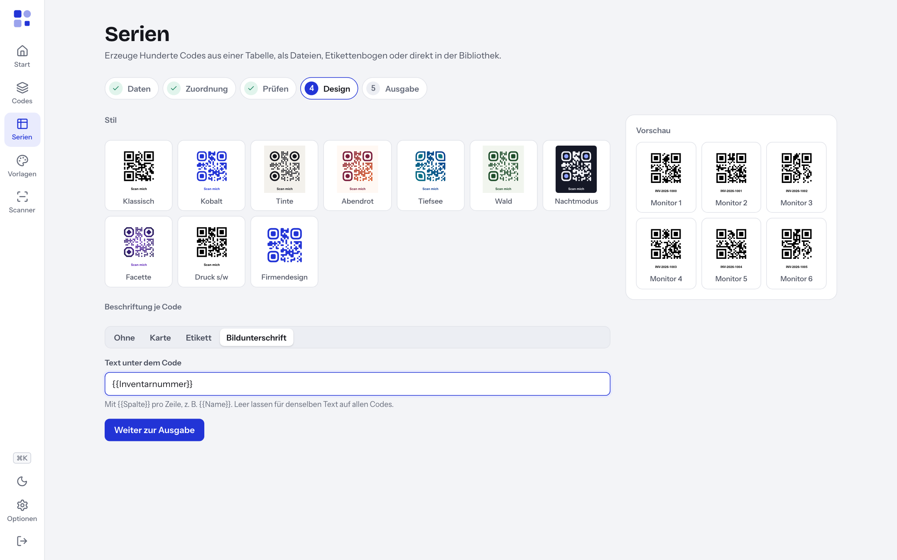

# 9 — Serien

Mit **Serien** erzeugen Sie viele Codes auf einmal aus einer Tabelle. Jede Zeile der Tabelle wird zu einem Code. Typische Fälle: Inventaretiketten, Raumschilder, Visitenkarten für ein ganzes Team, Zahlungscodes für Rechnungen.

Sie öffnen die Funktion über **Serien** in der Navigation. Die Rollen **Bearbeiten** und **Administration** sehen diesen Eintrag.

## Die fünf Schritte

Oben auf der Seite sehen Sie die Schritte **Daten**, **Zuordnung**, **Prüfen**, **Design** und **Ausgabe**. Sie können jederzeit zu einem früheren Schritt zurückspringen.

### Schritt 1: Daten

1. Wählen Sie unter **Welche Art von Code?** den Inhaltstyp, z. B. **Website** oder **Eigene Daten**.
2. Laden Sie die Tabelle auf einem dieser Wege:
   - **Datei:** Ziehen Sie die Datei auf das Feld **Tabelle ablegen oder auswählen** oder klicken Sie darauf. Erlaubt sind CSV, Excel (.xlsx), TSV und JSON.
   - **Einfügen:** Markieren Sie die Zellen in Excel, kopieren Sie sie und fügen Sie sie in **Oder Tabelle einfügen** ein. Klicken Sie dann auf **Eingefügte Tabelle verwenden**.

Die erste Zeile muss die Spaltennamen enthalten. Bei Excel-Dateien liest Tessera das erste Tabellenblatt.

Tipp: **Beispieltabelle für …** lädt eine CSV-Vorlage mit den passenden Spalten für den gewählten Typ. Füllen Sie diese aus und laden Sie sie wieder hoch.

### Schritt 2: Zuordnung

Unter **Spalten zuordnen** legen Sie fest, woher jedes Feld seinen Wert bekommt. Tessera schlägt passende Spalten anhand der Spaltennamen vor, z. B. „PLZ“ für Postleitzahl oder „Inventarnummer“ für den Inhalt. Pflichtfelder sind mit * markiert.

Für jedes Feld wählen Sie eine Quelle:

| Quelle | Bedeutung | Beispiel |
| --- | --- | --- |
| **Spalte** | Der Wert kommt aus einer Spalte. **– nicht verwenden –** lässt das Feld leer. | Spalte „Webadresse“ |
| **Fester Wert** | Derselbe Wert für alle Zeilen | „Kanzlei Muster“ als Firma |
| **Vorlage** | Text mit Platzhaltern `{{Spaltenname}}` | `https://firma.de/{{Raum}}` |

Das Feld **Name in Tessera** bestimmt, wie die Codes in der Bibliothek und in Dateinamen heißen. Standard ist die erste Spalte.

Rechts zeigt Tessera die ersten acht Zeilen der Tabelle zur Kontrolle. Klicken Sie auf **Weiter zur Prüfung**.

### Schritt 3: Prüfen

Tessera prüft jede Zeile, bevor etwas erzeugt wird.

- Oben steht z. B. **24 von 26 Zeilen sind gültig.** Fehlerhafte Zeilen werden übersprungen, bis Sie sie korrigieren oder die Zuordnung ändern.
- Die Tabelle zeigt (für die ersten 500 Zeilen) je Zeile **Status** (**OK** oder die Fehlermeldung), **Name** und **Inhalt**. Bei Typen mit vertraulichen Feldern (WLAN, GiroCode) zeigt Tessera statt des Inhalts nur eine Zusammenfassung.
- Tessera warnt, wenn Namen mehrfach vorkommen. In ZIP-Dateien erhalten Duplikate eine laufende Nummer.
- Tessera warnt bei Platzhaltern, deren Spalte es nicht gibt („Unbekannte Spalte in einer Vorlage“). Diese Stellen bleiben leer.

Korrigieren Sie Fehler am besten in der Tabelle selbst und laden Sie sie neu. Oder klicken Sie auf **Zuordnung ändern**. Weiter geht es mit **Weiter zum Design**.

### Schritt 4: Design

1. Wählen Sie unter **Stil** einen der kuratierten Stile oder eine eigene Vorlage (siehe [Kapitel 5](05-gestalten.md)).
2. Unter **Beschriftung je Code** wählen Sie einen **Rahmen**: **Ohne**, **Karte**, **Etikett** oder **Bildunterschrift**.
3. Mit Rahmen erscheint das Feld **Text unter dem Code**. Mit `{{Spalte}}` steht pro Zeile ein eigener Text unter dem Code, z. B. `{{Inventarnummer}}`. Lassen Sie das Feld leer, steht auf allen Codes derselbe Text. Die Beschriftung ist auf 40 Zeichen begrenzt.

Rechts sehen Sie eine **Vorschau** der ersten sechs Codes. Klicken Sie auf **Weiter zur Ausgabe**.

### Schritt 5: Ausgabe

Sie haben zwei Möglichkeiten, die Sie auch kombinieren können.

**Als Dateien:** Klicken Sie auf **Exportieren**. Unter **Ausgabe** wählen Sie:

- **Einzeldateien (ZIP):** PNG, SVG und/oder PDF, dazu **PNG-Breite** und **SVG/PDF-Breite** (in Millimetern). Die Auswahl 4096 px wird bei Serien auf 2048 px begrenzt. Das ZIP enthält eine Übersicht als CSV. Vertrauliche Inhalte wie WLAN-Passwörter stehen nicht darin.
- **Etikettenbogen (PDF):** **Papier** (A4, A3, US Letter), **Spalten**, **Zeilen** und **Name unter jeden Code drucken**. Feine Schnittlinien helfen beim Zuschneiden.

**In der Bibliothek speichern:** Wählen Sie **Art** (**Statisch** oder, bei passenden Typen, **Dynamisch (Kurzlink)**), optional einen **Ordner** und ein **Schlagwort**. Klicken Sie auf **… Codes speichern**. Danach zeigt der Knopf **Gespeichert**. Ein zweiter Klick legt keine Duplikate an. Erst wenn Sie etwas ändern, lässt sich erneut speichern.

**Wichtig bei dynamischen Serien:** Jeder Code bekommt einen eigenen Kurzlink. Der Export aus Schritt 5 enthält die Inhalte direkt. Exportieren Sie dynamische Codes deshalb nach dem Speichern aus der Bibliothek (Mehrfachauswahl → **Exportieren**, siehe [Kapitel 8](08-bibliothek.md)). Nur dann stehen die Kurzlinks im Code.

## Grenzen

| Grenze | Wert |
| --- | --- |
| Zeilen pro Durchgang | höchstens 5000 |
| Codes pro Etikettenbogen | höchstens 2000 |
| PNG-Breite in Serien | höchstens 2048 px |
| Gesamtumfang eines ZIP-Exports | begrenzt; bei zu vielen großen PNG-Dateien erscheint „Zu viele oder zu große Dateien auf einmal. …“ |
| Serienexporte gleichzeitig | einer pro Person |

Bricht der Browser den Download ab, stoppt die Erzeugung. Bei großen Serien kann der Export einige Zeit dauern, weil rechenintensive Aufträge nacheinander laufen.

## Beispiel: Inventaretiketten

Ziel: Für 120 Laptops soll je ein Etikett mit Code und Inventarnummer entstehen. Der Code enthält nur die Inventarnummer, damit ein Lagerscanner sie liest.

1. Legen Sie in Excel eine Tabelle an:

   | Inventarnummer | Gerät | Standort |
   | --- | --- | --- |
   | INV-2026-001 | Laptop 001 | Empfang |
   | INV-2026-002 | Laptop 002 | Sekretariat |

2. Öffnen Sie **Serien** und wählen Sie unter **Welche Art von Code?** den Typ **Eigene Daten**.
3. Kopieren Sie die Tabelle samt Kopfzeile aus Excel, fügen Sie sie unter **Oder Tabelle einfügen** ein und klicken Sie auf **Eingefügte Tabelle verwenden**.
4. **Zuordnung:** Tessera ordnet die Spalte „Inventarnummer“ dem Feld **Inhalt** zu. Stellen Sie **Name in Tessera** auf die Spalte „Gerät“.
5. **Prüfen:** Kontrollieren Sie, dass alle 120 Zeilen **OK** zeigen.
6. **Design:** Wählen Sie einen schlichten Stil, z. B. „Klassisch“ oder „Druck s/w“. Quadratische Augen lesen auch Industriescanner zuverlässig. Wählen Sie einen Rahmen und tragen Sie unter **Text unter dem Code** `{{Inventarnummer}}` ein.
7. **Ausgabe:** **Exportieren** → **Etikettenbogen (PDF)** → **Papier** A4, Spalten und Zeilen passend zu Ihren Etiketten → **PDF herunterladen**.
8. Optional: Speichern Sie die Codes unter **In der Bibliothek speichern** mit dem Schlagwort „Inventar 2026“.

Tipp: Vergeben Sie Nummern mit führenden Nullen. Bei der Sortierung **Name A–Z** ordnet die Bibliothek Namen alphabetisch, „Laptop 10“ stünde sonst vor „Laptop 2“.

---

← [8 — Bibliothek](08-bibliothek.md) | [Inhalt](README.md) | [10 — Dynamische Codes](10-dynamische-codes.md) →
