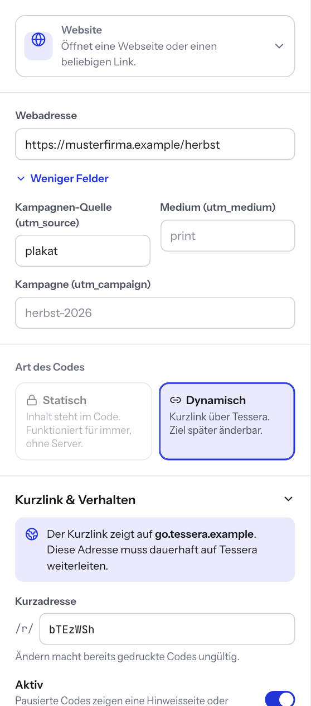

# 10 — Dynamische Codes

Ein dynamischer Code enthält nicht den eigentlichen Inhalt, sondern einen kurzen Link zu Tessera, z. B. `https://go.firma.de/r/k3Fq9xA`. Beim Scannen leitet Tessera auf das aktuelle Ziel weiter. Dadurch können Sie das Ziel nach dem Druck ändern, den Code pausieren oder ablaufen lassen.

Die Grundlagen zu statisch und dynamisch erklärt [Kapitel 1](01-was-ist-tessera.md).

## Welche Typen dynamisch sein können

| Verhalten | Typen |
| --- | --- |
| Weiterleitung auf eine Adresse | Website, WhatsApp, Standort, Terminbuchung, Social Media, App, Dokument, PayPal |
| Kleine Seite bei Tessera | Visitenkarte, Termin |
| Nur statisch | WLAN, Text, Anruf, E-Mail, SMS, GiroCode, Bitcoin, Eigene Daten |

Bei Typen, die nur statisch funktionieren, ist die Karte **Dynamisch** ausgegraut.

## Einen dynamischen Code anlegen

1. Erstellen Sie einen Code wie gewohnt (siehe [Kapitel 3](03-erster-code.md)).
2. Klicken Sie im Editor links unter **Art des Codes** auf **Dynamisch**.
3. Öffnen Sie den Bereich **Kurzlink & Verhalten** und prüfen Sie die Einstellungen (siehe unten).
4. Speichern Sie mit **Speichern** oder ⌘S bzw. Strg+S.

Erst nach dem Speichern ist der Kurzlink reserviert und funktioniert. Exportieren und drucken Sie den Code deshalb erst nach dem Speichern.

Ein einmal gespeicherter dynamischer Code bleibt dynamisch. So funktionieren bereits gedruckte Exemplare weiter.

## Einstellungen unter „Kurzlink & Verhalten“

| Feld | Bedeutung |
| --- | --- |
| **Kurzadresse** | Der Teil nach `/r/`. Tessera schlägt eine zufällige Adresse vor. Sie können eine eigene wählen, z. B. `/r/herbst`. Erlaubt sind 3 bis 64 Zeichen: Buchstaben, Ziffern, `-` und `_` (am Anfang ein Buchstabe oder eine Ziffer). Nach dem ersten Speichern gilt: Ändern macht bereits gedruckte Codes ungültig. |
| **Aktiv** | Ausschalten pausiert den Code. Pausierte Codes zeigen eine Hinweisseite oder leiten auf das Ersatzziel um. |
| **Läuft ab am** | Ab diesem Zeitpunkt gilt der Code als abgelaufen. Liegt das Datum in der Vergangenheit, warnt Tessera: Der Code ist damit sofort abgelaufen. |
| **Ersatzziel** | Wohin der Code führt, wenn er pausiert oder abgelaufen ist, z. B. `beispiel.de/aktion-beendet`. Leer lassen für eine Hinweisseite. |
| **Scans zählen** | Schaltet die Statistik für diesen Code ein (siehe unten) |

## Das Ziel ändern

1. Öffnen Sie den Code in der Bibliothek (**Codes** → Code anklicken bzw. **Bearbeiten**).
2. Ändern Sie den Inhalt, z. B. die Webadresse.
3. Klicken Sie auf **Speichern**.

Ab sofort führen alle gedruckten Exemplare zum neuen Ziel. Sie müssen nichts neu drucken. Tessera leitet mit einer vorübergehenden Weiterleitung (302) weiter. Browser merken sich das alte Ziel deshalb nicht.

## Was Besucher sehen

| Zustand | Ergebnis beim Scannen |
| --- | --- |
| Aktiv | Weiterleitung zum Ziel bzw. die gehostete Seite |
| Pausiert | Ersatzziel, sonst die Seite „Dieser Code ist pausiert“ |
| Abgelaufen | Ersatzziel, sonst die Seite „Dieser Code ist abgelaufen“ |
| Ziel unvollständig | Ersatzziel, sonst die Seite „Dieser Code ist noch nicht fertig“ |
| Im Papierkorb oder gelöscht | Die Seite „Diesen Code gibt es nicht“. Das Ersatzziel greift hier nicht. |

In der Bibliothek tragen pausierte und abgelaufene Codes die Kennzeichnung **Pausiert** bzw. **Abgelaufen**.

## Verlauf

Unter **Verlauf** zeigt Tessera die letzten Änderungen mit Zeitpunkt und Person: **Erstellt**, **Ziel geändert**, **Aktiviert**, **Pausiert**, **Kurzadresse geändert**. So sehen Sie nachträglich, wer das Ziel wann geändert hat.

## Gehostete Seiten: Visitenkarte und Termin

Eine vCard oder ein Termin mit vielen Angaben ergibt einen sehr dichten Code. Als dynamischer Code enthält er nur den Kurzlink und bleibt klein und gut lesbar.

- **Visitenkarte:** Beim Scannen erscheint eine kleine Seite mit Name, Position und Firma, Mobil, Telefon, E-Mail, Web und Adresse. Ein Tipp auf **Kontakt speichern** lädt die Kontaktdatei.
- **Termin:** Die Seite zeigt Titel, Ort, Beginn, Ende und Beschreibung. **In den Kalender eintragen** lädt die Kalenderdatei.

Ändern Sie später z. B. die Telefonnummer, zeigt die Seite sofort die neue Nummer.

## App-Link nach Gerät

Beim Typ **App** tragen Sie **App Store (iPhone, iPad)**, **Google Play (Android)** und **Für alle anderen Geräte** ein. Als dynamischer Code erkennt Tessera beim Scannen das Gerät und öffnet den passenden Store. Ein statischer Code kann nur ein Ziel haben. Das wählen Sie dort unter **Statischer Code führt zu**.

## Dateien in Tessera ablegen

Beim Typ **Dokument** wählen Sie unter **Quelle** entweder **Link zu einem Dokument** oder **Datei in Tessera ablegen (dynamischer Code)**.

1. Wählen Sie **Datei in Tessera ablegen (dynamischer Code)**.
2. Ziehen Sie die Datei auf **Datei ablegen oder auswählen** oder klicken Sie darauf. Erlaubt sind PDF, Bilder, Office-Dokumente, Text, ZIP, MP3 und MP4.
3. Speichern Sie. Tessera richtet den dynamischen Code automatisch ein.

Um die Datei zu ersetzen, klicken Sie erneut auf das Feld (**Klicken zum Ersetzen**) und speichern. Der gedruckte Code zeigt dann die neue Datei. Die maximale Dateigröße legt die IT fest (Standard 25 MB, für die Administration sichtbar unter **Einstellungen** → **System**). PDFs, Bilder (PNG, JPEG, GIF, WebP) und reine Textdateien öffnen sich im Browser, andere Dateien werden heruntergeladen.

## Intern oder öffentlich: Wer kann den Code scannen?

Das scannende Smartphone muss die Adresse im Kurzlink erreichen. Davon hängt ab, wo Sie den Code einsetzen können.

| Basisadresse | Beispiel | Funktioniert für |
| --- | --- | --- |
| Intern | `https://qr.intranet.firma.de` | Geräte im Firmennetz, im Firmen-WLAN oder per VPN. Geeignet für Aushänge im Büro, Geräteetiketten, interne Anleitungen. |
| Öffentlich | `https://go.firma.de` | Alle Smartphones mit Internet. Nötig für Flyer, Visitenkarten, Verpackungen, Schaufenster. |

Tessera zeigt im Bereich **Kurzlink & Verhalten** an, welcher Fall vorliegt. Bei einer internen Adresse steht dort: **Nur im internen Netz scanbar.** Eine Kundin, die den Code unterwegs scannt, erreicht den Link dann nicht.

Brauchen Sie einen öffentlichen Code, die Basisadresse ist aber intern, wenden Sie sich an Ihre IT. Alternativ nutzen Sie einen statischen Code. Er funktioniert ohne Tessera, solange das Ziel erreichbar ist.

### Basisadresse vor dem Druck festlegen

Die Basisadresse legt die Administration unter **Einstellungen** → **Dynamische Codes** → **Basisadresse für Kurzlinks** fest. Ist dort nichts festgelegt, verwendet Tessera `APP_URL`. Fehlt auch diese, gilt:

- Für die Administration schreibt Tessera beim ersten Speichern eines dynamischen Codes die aktuelle Adresse fest und weist darauf hin.
- Bearbeiter sehen den Hinweis, dass die Administration zuerst die Basisadresse festlegen muss. Bis dahin lässt sich kein dynamischer Code speichern.

Ändert sich die Basisadresse später, funktionieren bereits gedruckte Codes nur weiter, wenn die alte Adresse ebenfalls auf Tessera zeigt. Tessera fragt deshalb vor einer Änderung nach (**Basisadresse wirklich ändern?**). Neue Exporte enthalten die neue Adresse.

### Einrichtung (für IT)

- Basisadresse per Umgebungsvariable `PUBLIC_BASE_URL` setzen oder in der Oberfläche festlegen. Die Variable hat Vorrang. Dann zeigt die Oberfläche „Über die Umgebungsvariable PUBLIC_BASE_URL fest eingestellt.“
- Für öffentliche Codes eine öffentliche Domain per Reverse Proxy auf Tessera leiten, **nur für den Pfad `/r/`**. `APP_URL` bleibt die interne Adresse. Auf dem öffentlichen Host liefert Tessera dann ausschließlich Weiterleitungen und `/healthz` aus (`PUBLIC_HOST_REDIRECT_ONLY=true`, Standard). Das greift nur, wenn `APP_URL` oder `ALLOWED_HOSTS` gesetzt ist, damit Tessera interne und öffentliche Hosts unterscheiden kann.
- Als intern gelten u. a. `localhost`, einteilige Namen, private IP-Bereiche und Endungen wie `.local`, `.lan`, `.intern`, `.intranet`, `.corp`.
- Konfigurationsbeispiele für nginx, Caddy und Traefik: [../betrieb.md](../betrieb.md), Variablen: [../konfiguration.md](../konfiguration.md).

Einschränkung: Weiterleitung, Sperre der Oberfläche auf dem öffentlichen Host und Basisadresse wurden mit simulierten Host-Headern getestet. Ein Test mit echtem Reverse Proxy, TLS und öffentlicher Domain steht aus (siehe [../einschraenkungen.md](../einschraenkungen.md)).

## Statistik und Datenschutz

Tessera zählt standardmäßig **keine** Scans.

**Statistik erlauben (Administration):** Unter **Einstellungen** → **Datenschutz** schaltet die Administration **Scan-Statistik erlauben** ein. Erst dann lässt sich die Zählung pro Code einschalten. Ohne diese Erlaubnis ist der Schalter **Scans zählen** im Editor gesperrt mit dem Hinweis: „In den Einstellungen ist die Statistik ausgeschaltet. Ein Administrator kann sie dort erlauben.“

**Zählung pro Code:** Schalten Sie im Editor unter **Kurzlink & Verhalten** den Schalter **Scans zählen** ein. Nach dem Speichern zeigt Tessera **Scans gesamt**, **Letzte 30 Tage**, den Anteil **Smartphone**, ein Balkendiagramm der letzten 30 Tage und den Zeitpunkt des letzten Scans.

| | |
| --- | --- |
| **Gespeichert** | Anzahl der Scans je Tag, Anteil Smartphone/Computer |
| **Nie gespeichert** | IP-Adressen, Standorte, Cookies, vollständige Browserkennungen |
| **Nicht gezählt** | Linkvorschauen von Messengern, Bots sowie Browser mit „Do Not Track“ oder „Global Privacy Control“ |

Die Statistik ist bewusst minimal. Uhrzeiten einzelner Scans (außer dem Zeitpunkt des letzten Scans), Standort und Herkunftsseite erfasst Tessera aus Datenschutzgründen nicht. Die Zahlen sind deshalb ein Anhaltspunkt, keine exakte Messung: Wer „Do Not Track“ aktiviert hat, wird nicht mitgezählt.

## Rechte

Dynamische Codes anlegen und ändern dürfen **Bearbeiten** und **Administration**. Basisadresse und Statistik-Erlaubnis legt nur die **Administration** fest.

---

← [9 — Serien](09-serien.md) | [Inhalt](README.md) | [11 — Scanner](11-scanner.md) →
