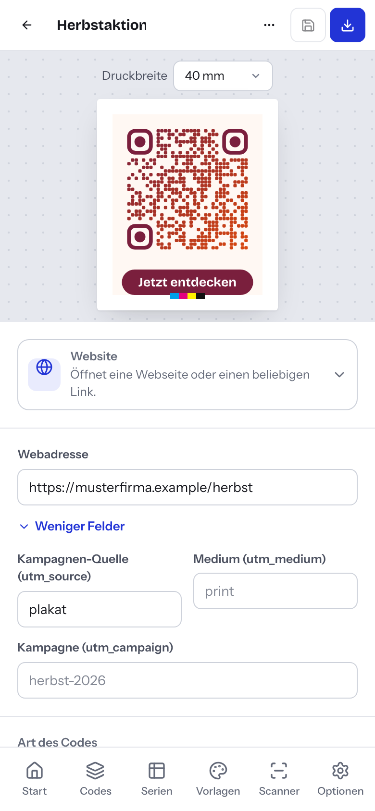

# 11 — Scanner

Der Scanner liest vorhandene Codes aus einem Bild, einem Screenshot oder über die Kamera. Das ist praktisch, wenn Sie einen alten Code nachbauen, neu gestalten oder einfach prüfen wollen, was darin steht. Das Lesen geschieht im Browser. Das Bild bleibt auf Ihrem Gerät.

Sie öffnen den Scanner über **Scanner** in der Navigation oder über die Befehlspalette (⌘K bzw. Strg+K) mit **Code scannen**.

## Code aus einem Bild lesen

1. Ziehen Sie ein Bild auf das Feld **Bild ablegen oder auswählen** oder klicken Sie darauf und wählen Sie die Datei.
2. Tessera zeigt **Wird gelesen …** und rechts das Ergebnis.

Geeignet sind PNG, JPG, SVG und Screenshots (außerdem z. B. GIF und WebP). Archive und Dokumente (z. B. PDF) kann der Scanner nicht lesen.

## Screenshot einfügen

1. Erstellen Sie einen Screenshot, z. B. von einer Webseite oder E-Mail mit QR-Code.
2. Öffnen Sie den Scanner und drücken Sie ⌘V bzw. Strg+V.

Tessera liest den Screenshot direkt aus der Zwischenablage.

## Mit der Kamera scannen

1. Klicken Sie auf **Mit der Kamera scannen**.
2. Erlauben Sie den Kamerazugriff im Browser.
3. Halten Sie den Code vor die Kamera. Tessera verwendet die Rückkamera, wenn vorhanden.
4. Mit **Kamera beenden** schalten Sie die Kamera ab.

Die Kamera funktioniert nur, wenn Tessera über HTTPS oder `localhost` aufgerufen wird. Das ist eine Vorgabe der Browser. Läuft Tessera im Intranet über reines HTTP, meldet der Scanner: „Die Kamera ist nur über HTTPS oder localhost verfügbar. Lade stattdessen ein Foto hoch.“ Das Hochladen von Bildern funktioniert immer. Wie die IT HTTPS einrichtet, steht in [Kapitel 2](02-installation.md) und in [../betrieb.md](../betrieb.md).

Hinweis: Die Kamera-Funktion konnte mangels Kamera in der Testumgebung nicht getestet werden. Das Lesen aus Bilddateien (PNG und SVG) ist getestet (siehe [../einschraenkungen.md](../einschraenkungen.md)).

## Das Ergebnis

Für jeden gefundenen Code zeigt Tessera:

- den erkannten Inhaltstyp, z. B. **Website**, **WLAN** oder **Visitenkarte**,
- das Codeformat und den Grund der Erkennung,
- den vollständigen Inhalt im Klartext.

Ein Bild darf mehrere Codes enthalten (bis zu acht). Neben QR-Codes liest der Scanner aus Bildern auch Micro-QR, DataMatrix, Aztec und PDF417. Die Kamera erkennt nur QR-Codes, und zwar einen: Sobald sie einen Code gelesen hat, schaltet sie sich ab und zeigt das Ergebnis.

| Knopf | Wirkung |
| --- | --- |
| **Im Studio gestalten** | Öffnet einen neuen Code im Editor. Typ und Felder sind bereits ausgefüllt. Sie gestalten ihn neu und speichern ihn. |
| **Kopieren** | Kopiert den Inhalt in die Zwischenablage |
| **Link öffnen** | Nur bei Webadressen: öffnet den Link in einem neuen Tab |

Erkennt Tessera den Kurzlink eines eigenen dynamischen Codes, bietet es zusätzlich an, diesen Code zu öffnen: **Dieser Code ist „…“ – öffnen**.

Findet Tessera nichts, erscheint **Kein Code gefunden.** Nehmen Sie dann ein schärferes Foto auf, bei dem der Code mehr Fläche einnimmt.

## Beispiel: Alten WLAN-Code im Kanzleidesign neu erstellen

1. Fotografieren Sie den alten WLAN-Aushang oder machen Sie einen Screenshot.
2. Laden Sie das Bild im **Scanner** hoch.
3. Prüfen Sie im Ergebnis Netzwerkname und Verschlüsselung.
4. Klicken Sie auf **Im Studio gestalten**.
5. Wählen Sie im Editor einen Stil, einen Rahmen mit Beschriftung „Gäste-WLAN“ und speichern Sie (siehe [Kapitel 5](05-gestalten.md)).

Beachten Sie: Ein WLAN-Code enthält das Passwort im Klartext. Jeder, der den Code scannt, kann es lesen. Das gilt auch für den Scanner.

## Smartphone und Tablet

Tessera passt sich an kleine Bildschirme an. Auf dem Smartphone liegt die Navigation als Leiste am unteren Bildschirmrand. In der Bibliothek ersetzt die Auswahl **Bereich** die linke Spalte. Für den Scanner ist das Smartphone besonders praktisch: Öffnen Sie Tessera dort über HTTPS, dann scannen Sie Codes direkt mit der Kamera.

---

← [10 — Dynamische Codes](10-dynamische-codes.md) | [Inhalt](README.md) | [12 — Benutzer und Anmeldung](12-benutzer-und-anmeldung.md) →
